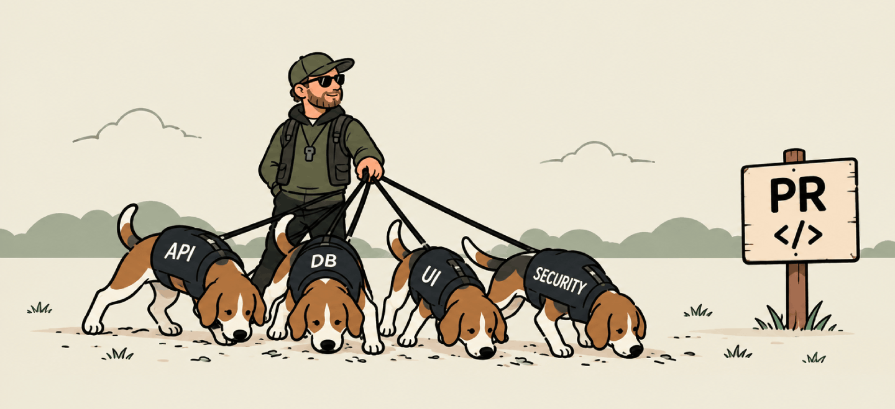

# houndsman

Orquestrador de revisão de Pull Requests. Classifica o diff, despacha **watchdogs**
especializados por domínio (um subagente por watchdog) e consolida os achados em um
relatório único.

> Review de PR no piloto automático: alguém aprova no "LGTM" sem ler, um `catch {}` engole
> o erro e ninguém nota. Sexta às 18h a produção cobra a conta — e aí todo mundo lembra
> daquela linha.



**Terminologia:** **houndsman** = orquestrador/treinador (CLI + motor) · **watchdog** = cada
agente especialista por domínio que audita o diff · **review/revisão** = o processo ·
**Jev** = pré-análise opcional. O vocabulário completo (brief, findings, manifest, budget,
overflow, churn, candidato…) está em [`docs/GLOSSARY.md`](docs/GLOSSARY.md).

---

## Como iniciar

Você monta o **seu time de cães de caça** (os watchdogs), cada um farejando um domínio
diferente das PRs. O motor só coordena a caçada — as regras são problema seu.

### 1. Pré-requisitos

- **Bun** — runtime obrigatório.
- **git** — o diff usa `git diff <base>...<head>`.
- Opcionais: **`gh`** (contexto da PR) e **`TYPESAFE_API_KEY`** (pré-análise Jev). A revisão
  funciona normalmente sem eles; o `houndsman doctor` valida a credencial Jev quando presente.

### 2. Instale o CLI (global)

```bash
bun add -g @payconductor/houndsman
```

### 3. Configure o projeto (uma vez)

Na raiz do projeto:

```bash
bun run houndsman setup
```

Cria a camada `.houndsman/`, que é **autocontida** (não instala nada no seu projeto):

| Caminho | Dono | O que é |
|---|---|---|
| `houndsman.config.ts` | você | Configuração do projeto (um objeto de dados) |
| `.houndsman/watchdogs/` | você | Suas regras — começa com **1 watchdog de exemplo** |
| `.houndsman/exclusions.ts` | você | Arquivos que nunca entram na revisão |
| `.houndsman/doc-mappings.ts` | você | path → documentação de contexto |
| `.houndsman/core/**` | auto | Tipos + docs do skill (sincronizados por `houndsman update`) |

> **Não existe "modo completo".** O `setup` já cria a camada inicial com um watchdog de
> exemplo — troque o exemplo pelas regras reais do seu projeto (ou use `/houndsman-update`).

### 4. Escreva suas regras

Edite `.houndsman/watchdogs/` — veja [Escrevendo boas regras](docs/AVANCADO.md#escrevendo-boas-regras).

### 5. Valide

```bash
bun run houndsman doctor
```

### 6. Rode a primeira revisão

No seu harness (Claude Code / agents), invoque o skill:

```
/houndsman
```

O skill orquestra tudo e grava o relatório em `.houndsman/.runs/<branch-slug>/review.md`.
Não precisa rodar nenhum script à mão.

---

## O fluxo de trabalho

```
/houndsman
   ├─ Passo 0  contexto da PR (gh, opcional)
   ├─ Passo 1  classifica o diff → briefs por watchdog
   ├─ Passo 2  N subagentes revisam em paralelo
   ├─ Passo 3  consolida em review.md + state.json
   └─ Passo 4  triagem (UI local ou agente)
```

- Revisão normal: só `/houndsman` (a branch é detectada; base default `main`).
- Revisar outra branch: `/houndsman feature/minha-branch`.
- Manual (sem skill): `houndsman context` → `houndsman --base main` → *(subagentes)* →
  `houndsman --finalize`.
- CI: `houndsman --finalize --fail-on-blocking` (exit 1 se houver bloqueantes).

---

## Triando os findings (opcional)

Depois do `--finalize`, cada finding tem um `id` curto e um `fingerprint` de **conteúdo**
no `.houndsman/.runs/<branch-slug>/state.json`. Você decide o que fazer com cada um — pela
**UI local** ou pelo **agente** (auto-fix) — sem abrir o JSON à mão:

```bash
bun run houndsman server --open     # UI: triar, comentar, marcar feito, ler artefatos
```

- **decision:** `pending` · `execute` · `ignore` (+ comentário).
- **execState:** `pending` · `in_progress` · `done` · `stale`.

**Auto-fix pelo agente** — as linhas mudam depois do fix, e o motor reancora por conteúdo:

```bash
bun run houndsman findings list --decision execute --json
bun run houndsman findings sync
bun run houndsman findings done <id>
```

> A identidade do finding é o **conteúdo** (fingerprint), não a linha: itens deslocados
> pelo fix não se perdem. O estado é local e mora em `.runs/<slug>/state.json` (gitignored).

---

## Mantendo a configuração

- **Alterar regras** → use o skill **`/houndsman-update`**. Ele prova no código que o padrão
  existe (evidência) antes de editar e roda as validações.
- **Atualizou a lib?** Sincronize os arquivos auto-gerados sem tocar nas suas regras:

  ```bash
  bun run houndsman update
  bun run houndsman doctor
  ```

  O `update` reescreve **só** `.houndsman/core/**` e `.houndsman/.gitignore`. Seus arquivos
  (`watchdogs/`, `exclusions.ts`, `doc-mappings.ts`, `houndsman.config.ts`) nunca são tocados.
- **Recomeçar a camada do zero** → `houndsman setup --force` (sobrescreve só os arquivos do
  usuário; sem `--force` o `setup` é idempotente).

---

## Documentação

- `docs/AVANCADO.md` — como funciona por dentro (diagrama do fluxo e onde o Jev entra),
  referência de comandos e boas práticas para escrever regras.
- `docs/GLOSSARY.md` — glossário do vocabulário de domínio (brief, findings, manifest,
  budget, overflow, churn, candidato, Jev…): o que cada termo significa **neste** projeto.
- `docs/CONTRIBUTING.md` — arquitetura, fluxos internos, princípios e desenvolvimento da
  lib (para quem vai contribuir).

- `src/skill/SETUP.md` — referência de configuração passo a passo.
- `src/skill/houndsman.md` — orquestração do skill `/houndsman`.
- `src/skill/houndsman-update.md` — manutenção das regras dos watchdogs.
