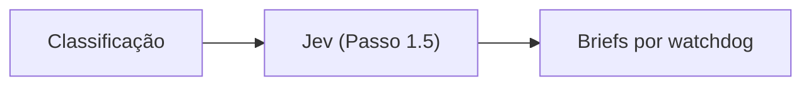

# houndsman — guia avançado

> Tópicos além do [README](../README.md): como o motor funciona por dentro, onde o Jev entra,
> referência de comandos e boas práticas para escrever regras.

---

## Como a mágica funciona

O `/houndsman` é um **maestro, não um revisor**. O CLI não lê o diff procurando bugs — isso é
trabalho dos subagentes (watchdogs). O que ele entrega é o *encanamento*: transforma um diff
bruto em **contextos determinísticos** (um brief por domínio) e, no fim, transforma JSONs
soltos em um **relatório único**. O LLM caro só é gasto onde importa: julgar o código.


**Na ordem em que acontece:**

1. **Skill → CLI.** O agente principal invoca `/houndsman`; o skill chama o binário `houndsman`
   (nada de script manual).
2. **Diff → classificação.** O CLI coleta o diff **uma única vez** (`git diff` + `--numstat`) —
   o custo não cresce com o nº de arquivos —, aplica as exclusions e classifica cada arquivo
   pelo `classify` que cada watchdog declara. Além de `filename`/`content`, regras podem usar
   fatos do **AST** (`symbol`, `import`, `export`, `decorator`) quando a grammar está disponível.
   Cada arquivo ganha também o **churn** (linhas adicionadas/removidas). Arquivo sem dono fica
   `unclassified`.
3. **Briefs determinísticos.** Para cada watchdog ativado, o CLI renderiza um brief com **só**
   os arquivos do domínio dele + **só** as regras daquele domínio. Nunca o diff completo. Os
   arquivos entram **priorizados por churn** e limitados pelo **orçamento** (ver abaixo). O
   brief também traz o **escopo do diff** — as faixas revisáveis de cada arquivo (ver abaixo).
4. **Despacho em ondas.** O agente principal cria **um subagente por brief**, despachados em
   ondas (ex.: até 8 por bloco de chamadas) para não estourar rate limit. Cada watchdog recebe
   apenas o seu contexto — nunca o dos outros.
5. **Findings em JSON.** Cada watchdog grava `findings/<id>.json` com schema fixo
   (`OUTPUT-FORMAT.md`) — markdown livre não consolida.
6. **Consolidação.** `houndsman --finalize` valida os JSONs, deduplica por `(file, line, rule)`
   (watchdogs sobrepostos não geram achado duplicado), agrupa por severidade **e por arquivo**
   e persiste a triagem no storage — cada finding ganha um `id` e um **fingerprint de conteúdo**
   (a linha é cache, não identidade), base da triagem (Passo 4).
7. **Resumo final.** O CLI grava **um único** artefato humano, `review-resume.md`: modelo de
   intenção, pontos técnicos, tabela de cobertura por domínio (achados · revisados/esperados ·
   faltam), candidatos não confirmados e conclusão. Achados individuais ficam na triagem
   (`findings`) e na UI — não são duplicados em markdown.
8. **Triagem (opcional).** `houndsman server` abre a UI local para marcar cada finding como
   `pending`/`execute`/`ignore` e acompanhar a execução; o agente usa
   `houndsman findings list/set/done/sync` para o auto-fix (as linhas mudam — o motor reancora
   por conteúdo). A sidebar tem uma rail vertical de seções — **Execuções** e **PRs** —
   com painel expansível: a segunda lista as PRs abertas via `gh`, faz checkout quando a
   árvore está limpa e abre a run correspondente. A aba **Comentários** carrega, sob
   demanda, as threads da PR da branch (cache de 60s).

### Orçamento por brief (PRs grandes)

Num PR de milhares de linhas, um único domínio pode concentrar centenas de arquivos — e um brief
com todos eles estouraria o contexto do subagente. O motor corta isso com um **orçamento**: no
máximo `budgets.maxFilesPerBrief` arquivos por brief (default **40**), **os de maior churn**.

- O excedente vira a seção **Fora do orçamento (NÃO revisar)** no brief: o watchdog **não** os
  lê, mas deve registrá-los em `skipped`.
- A tabela de **Cobertura** mostra o que ficou de fora (`faltam N`) — **nada some em silêncio**.
- Opcional no `houndsman.config.ts`:

```ts
budgets: { maxFilesPerBrief: 60 },
concurrency: { jev: 8 },
```

> Em PRs pequenos o orçamento não muda nada (o default de 40 raramente é atingido).

### Custo e latência da revisão

O tempo de uma revisão é dominado por **turns dos subagentes** (ler arquivo/código) e por
**chamadas de IA do prepare**. O motor corta os dois:

- **Trechos alterados no brief.** Todos os watchdogs recebem `## Trechos alterados (diff)`
  (patch `-U0`, só linhas alteradas). O teto é **rateado entre todos os arquivos** do brief
  (metade em partes iguais, o resto por churn): 24k/brief e 4k/arquivo no domínio,
  32k/5k no `general`. Trecho cortado vem marcado (`… [trecho truncado]`), nunca como se
  fosse o diff inteiro.
- **Orçamento de exploração.** O brief declara o teto de leitura/busca do subagente
  (6/6 por domínio, 10/10 no `general`). Sem prova dentro do brief + orçamento, não há
  achado — é o que impedia o `general` de gastar 10+ minutos rastreando a PR inteira.
- **Recorte por fluxo do `general`.** Acima de **40 arquivos** ou **2.000 linhas alteradas**,
  o `general` deixa de amostrar 40 arquivos (~800 chars cada) e passa a revisar os arquivos
  citados pelos **fluxos do modelo de intenção** + os de maior churn, limitados a 15 com
  diff de até 2k cada. O restante é declarado em `skipped` (`fora do fluxo`) — profundidade
  nos arquivos que importam para a lógica, com a lacuna explícita.
- **Prioridade por caminho (config-driven).** Cada regra tem `bonus` (promove; em linhas de churn
  equivalentes) e/ou `maxRiskFromChurn` (teto do churn considerado). O risco é
  `min(churn, teto) + bonus`:

  ```ts
  priorities: [
  	{ pattern: /^server\/src\/(db|repositories)\//, bonus: 300 },
  	{ pattern: /^server\/src\/(services|use-cases)\//, bonus: 200 },
  	{ pattern: /^(client|admin)\//, maxRiskFromChurn: 120 },
  ]
  ```

  Um arquivo de 20 linhas em `db` vale 320 e ganha de 2.000 linhas de UI reformatada (120);
  abaixo do teto o caminho mantém o peso natural do churn (15 linhas = 15). Ordena o orçamento,
  o rateio do diff e o recorte do `general`; sem regra, churn puro.
- **Propagação mecânica.** Micro-alterações idênticas (≤3 linhas) em ≥5 arquivos viram **um**
  bloco no brief: padrão dominante + outliers, em vez de N diffs de uma linha. E contratos
  alterados cujos importadores **não** estão no diff aparecem em *Possível propagação
  incompleta* (o caso "atualizaram 100 e esqueceram 3").
- **Modelo de intenção recortado.** O `general` vê o modelo completo; cada domínio recebe só
  os fluxos que tocam seus arquivos (e não recebe o caminho do JSON canônico), evitando que
  persiga fluxos de outros watchdogs.
- **Fases do prepare em paralelo.** Contexto ∥ pré-análise, depois intenção, depois hipóteses
  do `general` ∥ resumo técnico ∥ planos de brief. `ai.concurrency` default **4**.
- **Harness em uma onda.** `hunt.concurrency` default **8** — domínios + `general` rodam
  juntos; `--hunt-concurrency` ajusta se o provider limitar a taxa.
- **Checklist de intenção no harness.** Cada fluxo/invariante do brief vira item de `checks`;
  se faltar verificação, o watchdog roda **uma** segunda passada só com os pendentes e os
  findings são unidos (dedupe por arquivo+linha+regra, maior severidade vence). O
  `businessSummary` que o `general` devolve só substitui o modelo vigente quando tem
  pontuação maior — sem isso ele já trocou um modelo da IA (5 fluxos) por um resumo de 4
  invariantes. `--no-checklist`/`hunt.checklist: false` desliga a passada extra.
- **Saída do maki e retries.** O `result` do maki concatena o texto de **todos** os turnos;
  o parser extrai o **último** JSON válido (fence ou objeto balanceado). Se a saída ainda
  não for parseável, o retry retoma a sessão (`--resume`) com o schema e não repete a
  exploração. O system prompt do harness inverte a preferência nativa do maki por
  “minimizar tool calls”: profundidade vence brevidade.
- **Despacho da skill.** Despache todos os briefs da onda no **mesmo bloco** de tool calls;
  serializar N subagentes custa N × o tempo de um.

Para diagnosticar, o prepare grava `prepare-report.json` (duração por etapa + uso de IA,
**tentativas e falhas** por feature) e o CLI imprime cada etapa. No `houndsman hunt`,
`hunt-report.json` traz `durationMs`, `numTurns` e tokens por watchdog.

### Teste A/B (variantes da mesma PR)

A identidade de uma run é `(repoKey, branch, variant)`. Rótulos de variante permitem rodar a
mesma PR duas vezes **sem apagar** a anterior:

```bash
# A: baseline
houndsman --pr 456 --variant baseline
houndsman --pr 456 --variant baseline --finalize

# B: candidato (prompt/modelo/configuração nova)
houndsman --pr 456 --variant otimizado
houndsman --pr 456 --variant otimizado --finalize

houndsman compare --branch <head> --a baseline --b otimizado
```

- `--variant <label>` acompanha `houndsman` (default), `hunt`, `context`, `status`,
  `findings` e `verify` — use o mesmo rótulo em todas as etapas.
- A UI lista cada variante como uma run (`--variant` aparece como badge na sidebar).
- `compare` aceita `--branch` + `--a/--b` ou dois slugs (`houndsman compare <a> <b>`), e
  `--list` mostra as runs da branch com contagem por severidade. O relatório
  `compare-<a>--<b>.md|.json` fica nos artefatos da run B.
- O relatório compara **achados presentes**, severidade, cobertura, duração e tokens — não
  elege vencedor; confirme cada achado novo no código.
- Tokens/custo aparecem quando medidos: `hunt-report.json` (harness maki) ou `ai-usage.json`
  (IA do prepare). No modo skill, o consumo dos subagentes não passa pelo CLI.
- Repetir a mesma variante reusa a run: `--full` re-revisa o commit. Para um teste limpo,
  use um rótulo novo.

### Onde o Jev entra

O **Jev** é o **Passo 1.5** — roda **dentro do CLI, na mesma etapa do Passo 1 (preparar)**,
**depois** da classificação e **antes** de os subagentes serem despachados. Em outras palavras:
ele *aquece* os briefs antes do despacho.



- **O que faz:** se `HOUNDSMAN_TYPE_SAFE_API_KEY` existir, o Jev avalia cada arquivo contra as regras
  *atômicas* dos watchdogs que o cobrem. Respostas acima do limiar de confiança viram
  **candidatos** (`candidates.json`).
- **O que muda:** os candidatos entram no brief como *warm start* — **não são achados**. O
  subagente **confirma ou refuta**; os não confirmados caem em `🔎 Candidatos não verificados`
  no relatório final.
- **Opcional:** sem chave, erro ou timeout → `available:false` e a revisão roda idêntica. É
  **pré-análise, nunca gate**. Para desligar: `houndsman --no-jev`.
- **O que não faz:** o Jev **não decide severidade**. Cada pergunta é `noul`/`choice`/`score`
  e a severidade do candidato já vem da regra. A severidade dos achados é ancorada de forma
  determinística (`Rule.severity` para finding de regra, `impactClass` para emergente).

Resumindo o papel de cada um: **o Jev sugere, os watchdogs decidem, o CLI consolida.**

### Escopo do diff (símbolos alterados)

Revisar o arquivo inteiro faz o watchdog reportar problemas **pré-existentes**, fora do que a
PR mudou. O motor calcula um escopo determinístico no `prepare` e o injeta no brief e na
pré-análise:

- **Âncoras:** `git diff -U0` (sem truncar) — linhas adicionadas + posição no lado novo das
  linhas removidas (mudança puramente de remoção também conta).
- **Símbolos:** para cada âncora, o **menor símbolo folha** do AST que a contém
  (função/método/tipo/enum/propriedade/interface). Containers (classe/interface/enum) não
  expandem sozinhos; âncoras fora de símbolo (imports, topo do módulo) viram faixas avulsas.
- **Fallback:** sem grammar ou com `--no-ast`, valem as faixas dos hunks.
- **Persistência:** o escopo fica em `classification.json` (`changedScope`) e é a fonte única
  do brief, da tool `review_scope` e dos prompts.

> Um finding só é válido com `line` dentro das faixas. Código fora delas é contexto para
> entender o impacto. Se a mudança quebra algo não alterado, o finding ancora na linha
> alterada que causou o problema.

### AST determinístico (TS/JS)

O AST roda **antes** dos briefs e **sem LLM**: `web-tree-sitter` (wasm embarcado) parseia os
arquivos alterados e produz fatos estruturais, delta e impacto. É a camada que dá “inteligência”
barata à classificação e ao contexto.

- **Fatos por arquivo:** símbolos (função/classe/método/interface/tipo/enum/variável), imports,
  exports, decorators e assinaturas.
- **Delta:** compara a versão base com a atual e o patch do arquivo — símbolos adicionados,
  removidos e alterados, mudanças de assinatura, imports e exports.
- **Impacto reverso:** usa `git grep` pelo nome do módulo e confirma o import resolvido
  (relativo ou alias) — devolve quem importa os arquivos alterados e quais exports públicos
  mudaram.
- **Brief:** a seção `Estrutura (AST)` entra no brief como **mapa de leitura**, nunca como
  achado. O watchdog confirma no código.
- **Artefatos:** `ast-summary.json` e `ast-impact.json` ficam no storage para auditoria.
- **Fail-open:** grammar ausente, ABI incompatível, arquivo grande/binário ou erro de git
  desligam o AST naquela run. O regex continua sendo o fallback e `unclassified` continua
  existindo. Desligar: `--no-ast` ou `ast: { enabled: false }`.

Config opcional no `houndsman.config.ts`:

```ts
ast: {
	aliases: { "@/*": "src/*" },
	maxFileBytes: 512_000,
	maxImpactFiles: 200,
},
```

### Review incremental e `verify`

- **Incremental:** cada `--finalize` grava o commit revisado (`reviewedSha` da review).
  O prepare seguinte revisa **só o delta** (arquivos alterados desde então) e **carrega** os
  findings dos arquivos inalterados (carry-over). Sem mudanças → no-op; rebase/force-push → review
  completo. Forçar completo: `houndsman --full`.
- **`findings verify`:** confere se as violações foram resolvidas **sem re-revisar a PR** — tier
  local (reancoragem por conteúdo, grátis) + Jev só nos casos ambíguos (diff focado
  `foundAtSha..HEAD`, uma pergunta por finding). `--apply` marca os `resolved` como `done`;
  o `verify.md` fica no storage e pode ser lido na UI.

### Revisando várias PRs em paralelo (worktrees)

O clone principal pode continuar no seu branch de trabalho enquanto as PRs são revisadas
em worktrees isoladas:

- `houndsman --pr <n>` consulta a PR via `gh`, busca `refs/pull/<n>/head` (funciona em
  forks), cria o worktree **detached** no commit do head e roda o prepare ali.
- `--worktree <path>` usa um worktree já existente (ex.: criado à mão); informe
  `--branch` se ele estiver em detached HEAD.
- A review continua identificada por `(repositório, branch)`; `worktreePath` e
  `prNumber` ficam gravados no storage e são usados por `findings`, `verify` e pela UI
  para ler os arquivos certos.
- `houndsman worktree list|add|remove|prune|path` administra os diretórios em
  `<repo>/.houndsman/worktrees/<repo>/<branch>` (default).
- Duas revisões em branches diferentes usam workspaces distintos e podem rodar ao mesmo
  tempo; o SQLite já opera em WAL e o staging é por `reviewId`.

#### Por que dentro do workspace (e como mudar)

O default `worktrees.location: "workspace"` mantém worktree **e staging**
(`briefs/`, `findings/`, contexto) dentro da pasta aberta no editor. Isso evita que
agentes de codificação peçam permissão a cada leitura/execução fora do workspace. O
diretório é auto-ignorado pelo git.

```ts
// houndsman.config.ts
export default defineHoundsmanConfig({
  // ...
  worktrees: { location: "workspace" }, // default
  // worktrees: { location: "home" },   // <HOUNDSMAN_HOME>/worktrees
  // worktrees: { location: "../wt" },   // caminho relativo à raiz do repo
});
```

Se o agente continuar pedindo permissão, confirme que ele está aberto na raiz do
repositório (não em uma subpasta) e que o caminho do worktree está sob ela.

---

## Intenção e revisão de fluxo (`general`)

Revisar só por regra acha padronização — não acha gap de fluxo. Por isso o motor trata a
**intenção** como insumo obrigatório:

1. O `prepare` grava `business-summary.json` com o que a PR **deve** entregar (`intent`,
   `flows`, `invariants`, `contracts`, `states`) e um `business-brief.md` para o passo.
2. Quem produz o modelo, em ordem de precedência:
   - **IA no prepare** (`HOUNDSMAN_DEEP_SEEK_API_KEY`) → `source: "ai"`;
   - **subagente** na skill, quando não há chave → `source: "reviewer"`;
   - **pré-passe maki** no `houndsman hunt` (IA embutida) → `source: "reviewer"`;
   - **determinístico** (AST + churn + contexto) como fallback.
3. O watchdog reservado **`general`** é injetado em todo ciclo, com todos os arquivos
   alterados, e audita o fluxo ponta a ponta. Ele sempre pode emitir `Lógica:`/`Domínio:`;
   `blocking` fora de regra exige `scenario` + `evidence` (sem os dois, vira `attention`).

O `general` não é configurável nem pode ser removido: é parte do fluxo, como o escopo do diff.
Se o consumidor declarar um watchdog com id `general`, os metadados são mesclados ao piso do
motor e o `doctor` avisa.

---

## Comandos do dia a dia

| Comando | Função |
|---|---|
| `houndsman setup` | Cria a configuração inicial do projeto |
| `houndsman update` | Sincroniza os arquivos auto-gerados (`.houndsman/core`) |
| `houndsman doctor` | Valida a configuração, o ambiente e a credencial Jev |
| `houndsman context` | Passo 0 — contexto da PR via `gh` |
| `houndsman --base main` | Passo 1 — prepara os briefs |
| `houndsman --pr <n>` | Prepara a PR em um worktree dedicado |
| `houndsman --worktree <path>` | Prepara em um worktree já existente |
| `houndsman --finalize` | Passo 3 — gera o relatório |
| `houndsman hunt [--pr <n>]` | Harness local opcional (maki): prepare → watchdogs → finalize |
| `houndsman hunt install` | Baixa o maki fixado para `<HOUNDSMAN_HOME>/tools/maki` |
| `houndsman worktree <ação>` | `list`/`add`/`remove`/`prune`/`path` dos worktrees |
| `houndsman watchdog <id>` | Contexto de um watchdog (`--rules`, `--json`) |
| `houndsman findings <sub>` | Triagem/correção dos findings (`list`/`show`/`set`/`done`/`reset`/`sync`/`summary`/`batch`/`verify`/`path`) |
| `houndsman server` | UI local de triagem + leitura de artefatos (`--port`, `--host`, `--open`, `--editor`) |

Flags: `--base <branch>` (default `main`) · `--head <ref>` (default `HEAD`) ·
`--branch <nome>` · `--pr <n>` · `--worktree <path>` · `--config <path>` · `--clean` ·
`--full` · `--no-jev` · `--no-ast` · `--no-ai` · `--fail-on-blocking` (com `--finalize`) ·
`--allow-partial` · `--no-context` · `--hunt-model` · `--hunt-concurrency` · `--hunt-timeout`
(com `hunt`) · `--editor <auto|vscode|jetbrains|none>` (com `server`).

---

## Escrevendo boas regras

O texto da regra é renderizado **literalmente** no brief do subagente — ambiguidade vira
ruído na revisão. Toda regra começa com um **prefixo de polaridade**:

- `Promover:` → algo que **DEVE** acontecer (o padrão precisa existir no código).
- `Evitar:` → algo que **NÃO DEVE** acontecer. `Não` e `Nunca` no início são equivalentes.

Boas práticas:

1. **Só regra que o projeto aplica hoje** — prove com evidência (`arquivo:linha` para
   afirmativas; `0 ocorrências via grep` do anti-padrão para negativas). Regra afirmativa sem
   aplicação real gera falso positivo.
2. **Geral e reutilizável** — descreva um padrão do domínio, não uma regra de negócio
   amarrada a uma única classe/use-case (isso é papel de teste automatizado).
3. **Condição inequívoca e critério concreto** — duas IAs chegam à mesma conclusão; use
   limite/lista explícita ou símbolo real do código.
4. **Sem jargão vago nem qualificador vazio** — nada de "o antigo", "isso", "apenas por
   compatibilidade".
5. **Declare o `classify`** do watchdog — regex de path (`filename`) ou de conteúdo
   (`content`) para o motor achar os arquivos do domínio.
6. **Prefira editar via `/houndsman train`** — aplica a rubrica completa e roda as
   verificações (`doctor`, `test`).

> `houndsman doctor` emite um aviso (não bloqueante) para regra sem prefixo de polaridade.

Exemplo:

```ts
{ severity: "blocking",  text: "Evitar: handler de webhook processa o payload antes de validar a assinatura do provider." }
{ severity: "attention", text: "Promover: rotas validam a entrada com o schema do domínio." }
```

---

## Estrutura gerada por `setup`

```
houndsman.config.ts
.houndsman/
├── .gitignore            # AUTO
├── core/                 # AUTO — sincronizado por `update`
│   ├── types.ts
│   └── skill/*.md
├── watchdogs/            # você — 1 módulo .ts por watchdog
│   └── index.ts
├── exclusions.ts         # você
└── doc-mappings.ts       # você
```

Cada review, seus findings e artefatos ficam no **storage global** — SQLite em
`<HOUNDSMAN_HOME>/houndsman.db` (default), com `storage.provider: "file"` como fallback.
O staging dos subagentes (`briefs/`, `findings/`, contexto) fica em
`<HOUNDSMAN_HOME>/work/<reviewId>/` e é limpo após o `--finalize`. Nada é gravado em
`.houndsman/.runs`.
