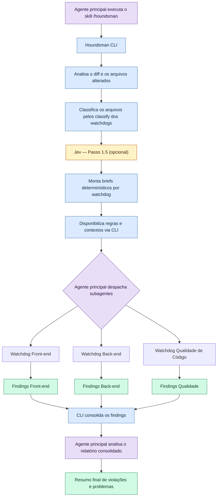
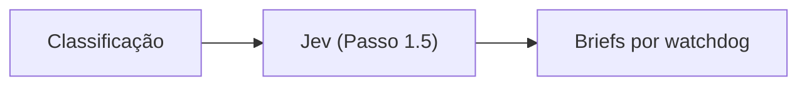

# houndsman — guia avançado

> Tópicos além do [README](../README.md): como o motor funciona por dentro, onde o Jev entra,
> referência de comandos e boas práticas para escrever regras.

---

## Como a mágica funciona

O `/houndsman` é um **maestro, não um revisor**. O CLI não lê o diff procurando bugs — isso é
trabalho dos subagentes (watchdogs). O que ele entrega é o *encanamento*: transforma um diff
bruto em **contextos determinísticos** (um brief por domínio) e, no fim, transforma JSONs
soltos em um **relatório único**. O LLM caro só é gasto onde importa: julgar o código.



**Na ordem em que acontece:**

1. **Skill → CLI.** O agente principal invoca `/houndsman`; o skill chama o binário `houndsman`
   (nada de script manual).
2. **Diff → classificação.** O CLI coleta o diff **uma única vez** (`git diff` + `--numstat`) —
   o custo não cresce com o nº de arquivos —, aplica as exclusions e classifica cada arquivo
   pelo `classify` (regex de path ou de conteúdo) que cada watchdog declara. Cada arquivo ganha
   também o **churn** (linhas adicionadas/removidas). Arquivo sem dono fica `unclassified`.
3. **Briefs determinísticos.** Para cada watchdog ativado, o CLI renderiza um brief com **só**
   os arquivos do domínio dele + **só** as regras daquele domínio. Nunca o diff completo. Os
   arquivos entram **priorizados por churn** e limitados pelo **orçamento** (ver abaixo).
4. **Despacho em ondas.** O agente principal cria **um subagente por brief**, despachados em
   ondas (ex.: até 8 por bloco de chamadas) para não estourar rate limit. Cada watchdog recebe
   apenas o seu contexto — nunca o dos outros.
5. **Findings em JSON.** Cada watchdog grava `findings/<id>.json` com schema fixo
   (`OUTPUT-FORMAT.md`) — markdown livre não consolida.
6. **Consolidação.** `houndsman --finalize` valida os JSONs, deduplica por `(file, line, rule)`
   (watchdogs sobrepostos não geram achado duplicado), agrupa por severidade **e por arquivo** e
   grava um `review.<watchdog>.md` por domínio com achados. Também grava
   `.houndsman/.runs/<slug>/state.json` — cada finding ganha um `id` e um **fingerprint de
   conteúdo** (a linha é cache, não identidade), base da triagem (Passo 4).
7. **Leitura final.** O agente principal lê o `review.md` consolidado e produz o resumo de
   violações e problemas.
8. **Triagem (opcional).** `houndsman server` abre a UI local para marcar cada finding como
   `pending`/`execute`/`ignore` e acompanhar a execução; o agente usa
   `houndsman findings list/set/done/sync` para o auto-fix (as linhas mudam — o motor reancora
   por conteúdo).

### Orçamento por brief (PRs grandes)

Num PR de milhares de linhas, um único domínio pode concentrar centenas de arquivos — e um brief
com todos eles estouraria o contexto do subagente. O motor corta isso com um **orçamento**: no
máximo `budgets.maxFilesPerBrief` arquivos por brief (default **40**), **os de maior churn**.

- O excedente vira a seção **Fora do orçamento (NÃO revisar)** no brief: o watchdog **não** os
  lê, mas deve registrá-los em `skipped`.
- A tabela de **Cobertura** mostra o que ficou de fora (`faltam N`) — **nada some em silêncio**.
- Opcional no `houndsman.config.ts`:

```ts
budgets: { maxFilesPerBrief: 60 },
concurrency: { jev: 8 },
```

> Em PRs pequenos o orçamento não muda nada (o default de 40 raramente é atingido).

### Onde o Jev entra

O **Jev** é o **Passo 1.5** — roda **dentro do CLI, na mesma etapa do Passo 1 (preparar)**,
**depois** da classificação e **antes** de os subagentes serem despachados. Em outras palavras:
ele *aquece* os briefs antes do despacho.



- **O que faz:** se `TYPESAFE_API_KEY` existir, o Jev avalia cada arquivo contra as regras
  *atômicas* dos watchdogs que o cobrem. Respostas acima do limiar de confiança viram
  **candidatos** (`candidates.json`).
- **O que muda:** os candidatos entram no brief como *warm start* — **não são achados**. O
  subagente **confirma ou refuta**; os não confirmados caem em `🔎 Candidatos não verificados`
  no relatório final.
- **Opcional:** sem chave, erro ou timeout → `available:false` e a revisão roda idêntica. É
  **pré-análise, nunca gate**. Para desligar: `houndsman --no-jev`.

Resumindo o papel de cada um: **o Jev sugere, os watchdogs decidem, o CLI consolida.**

### Review incremental e `verify`

- **Incremental:** cada `--finalize` grava o commit revisado (`reviewed.headSha` no `state.json`).
  O prepare seguinte revisa **só o delta** (arquivos alterados desde então) e **carrega** os
  findings dos arquivos inalterados (carry-over). Sem mudanças → no-op; rebase/force-push → review
  completo. Forçar completo: `houndsman --full`.
- **`findings verify`:** confere se as violações foram resolvidas **sem re-revisar a PR** — tier
  local (reancoragem por conteúdo, grátis) + Jev só nos casos ambíguos (diff focado
  `foundAtSha..HEAD`, uma pergunta por finding). `--apply` marca os `resolved` como `done`;
  o `verify.md` fica na pasta da run.

---

## Comandos do dia a dia

| Comando | Função |
|---|---|
| `houndsman setup` | Cria a configuração inicial do projeto |
| `houndsman update` | Sincroniza os arquivos auto-gerados (`.houndsman/core`) |
| `houndsman doctor` | Valida a configuração, o ambiente e a credencial Jev |
| `houndsman context` | Passo 0 — contexto da PR via `gh` |
| `houndsman --base main` | Passo 1 — prepara os briefs |
| `houndsman --finalize` | Passo 3 — gera o relatório |
| `houndsman watchdog <id>` | Contexto de um watchdog (`--rules`, `--json`) |
| `houndsman findings <sub>` | Triagem/correção dos findings (`list`/`show`/`set`/`done`/`reset`/`sync`/`summary`/`batch`/`verify`/`path`) |
| `houndsman server` | UI local de triagem + leitura de artefatos (`--port`, `--host`, `--open`) |

Flags: `--base <branch>` (default `main`) · `--head <ref>` (default `HEAD`) ·
`--branch <nome>` · `--dir <dir>` · `--config <path>` · `--clean` · `--full` · `--no-jev` ·
`--fail-on-blocking` (com `--finalize`).

---

## Escrevendo boas regras

O texto da regra é renderizado **literalmente** no brief do subagente — ambiguidade vira
ruído na revisão. Toda regra começa com um **prefixo de polaridade**:

- `Promover:` → algo que **DEVE** acontecer (o padrão precisa existir no código).
- `Evitar:` → algo que **NÃO DEVE** acontecer. `Não` e `Nunca` no início são equivalentes.

Boas práticas:

1. **Só regra que o projeto aplica hoje** — prove com evidência (`arquivo:linha` para
   afirmativas; `0 ocorrências via grep` do anti-padrão para negativas). Regra afirmativa sem
   aplicação real gera falso positivo.
2. **Geral e reutilizável** — descreva um padrão do domínio, não uma regra de negócio
   amarrada a uma única classe/use-case (isso é papel de teste automatizado).
3. **Condição inequívoca e critério concreto** — duas IAs chegam à mesma conclusão; use
   limite/lista explícita ou símbolo real do código.
4. **Sem jargão vago nem qualificador vazio** — nada de "o antigo", "isso", "apenas por
   compatibilidade".
5. **Declare o `classify`** do watchdog — regex de path (`filename`) ou de conteúdo
   (`content`) para o motor achar os arquivos do domínio.
6. **Prefira editar via `/houndsman train`** — aplica a rubrica completa e roda as
   verificações (`doctor`, `test`).

> `houndsman doctor` emite um aviso (não bloqueante) para regra sem prefixo de polaridade.

Exemplo:

```ts
{ severity: "blocking",  text: "Evitar: handler de webhook processa o payload antes de validar a assinatura do provider." }
{ severity: "attention", text: "Promover: rotas validam a entrada com o schema do domínio." }
```

---

## Estrutura gerada por `setup`

```
houndsman.config.ts
.houndsman/
├── .gitignore            # AUTO
├── core/                 # AUTO — sincronizado por `update`
│   ├── types.ts
│   └── skill/*.md
├── watchdogs/            # você — 1 módulo .ts por watchdog
│   └── index.ts
├── exclusions.ts         # você
└── doc-mappings.ts       # você
```

Os artefatos de cada review ficam em `.houndsman/.runs/<branch-slug>/` (auto-ignorados) —
incluindo `state.json` (triagem) e `run.json` (status da run, exibido na UI).
